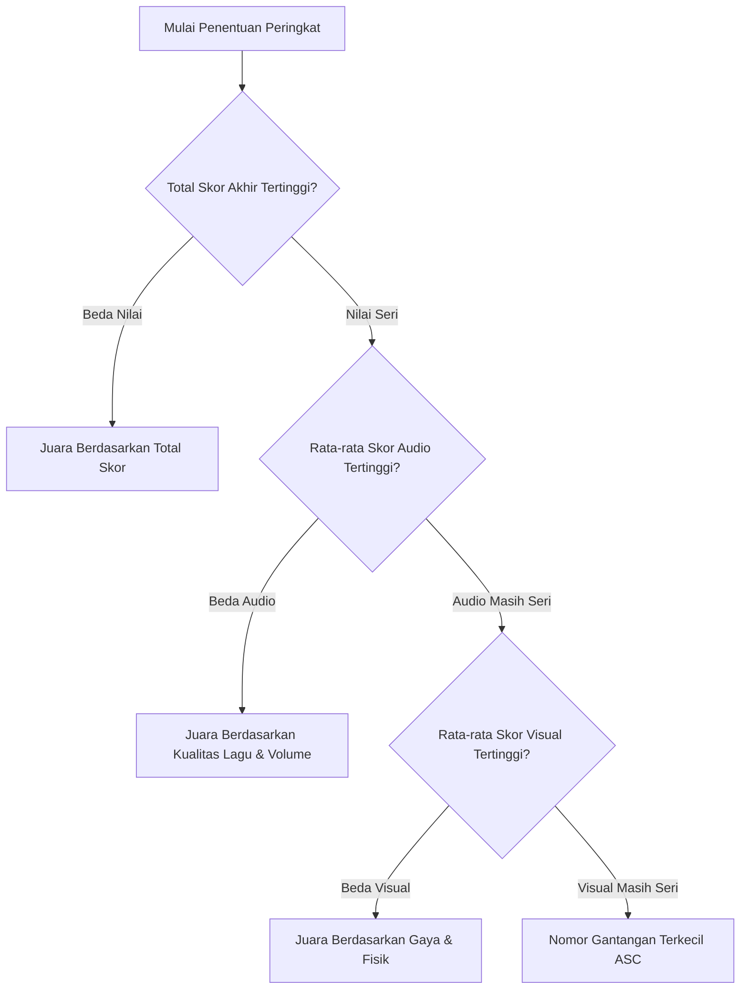

# 🏆 KicauScore
### *Real-Time Multi-Judge Avian Singing Competition Platform*

Platform sistem informasi cerdas untuk digitalisasi penjurian dan manajemen kompetisi burung berkicau secara **akurat, transparan, anti-bentrok, dan real-time**.

[🌐 Live Staging](https://kicaumania.ardmst.my.id) • [📊 Live Scoreboard](https://kicaumania.ardmst.my.id/scoreboard) • [🎯 Fitur Utama](#-fitur-unggulan) • [🛠️ Arsitektur](#%EF%B8%8F-arsitektur-dan-erd) • [🚀 Instalasi](#-panduan-instalasi-lokal) • [👥 Tim Pengembang](#-tim-pengembang-kelompok-3)

---

## 📌 Latar Belakang & Perbandingan Sistem

Pada kompetisi burung berkicau konvensional, penilaian puluhan burung di tiang gantangan masih mengandalkan kertas tancap fisik dan rekap manual. Hal ini memicu lamanya pengumuman juara, potensi salah hitung, nomor gantangan ganda, hingga isu kecurangan "burung titipan".

| Aspek Penilaian | Sistem Konvensional (Kertas Manual) | Platform Digital KicauScore |
| :--- | :--- | :--- |
| **Input Nilai Juri** | Kertas tancap fisik di bawah tiang | Mobile-First UI (langsung input dari smartphone juri) |
| **Kalkulasi Juara** | Rekap kalkulator manual di meja panitia | **Real-time Average Scoring Engine** otomatis |
| **Penanganan Nilai Seri** | Tos koin / debat juri subjektif | **4-Tier Tie-Breaker Engine** berstandar pakem PBI & BNR |
| **Integritas Skor** | Nilai kertas rentan diubah diam-diam | **Immutable Audit Trail** (`penilaian_logs`) & Lock Policy |
| **Alokasi Gantangan** | Catat WhatsApp manual (rawan *double-booking*) | **Atomic Allocation** (`DB::transaction` & `lockForUpdate`) |
| **Publikasi Hasil** | Tunggu papan tulis diumumkan berjam-jam | **Live Scoreboard Asinkron (Auto-Polling 10 detik)** |
| **Histori Prestasi Burung** | Piagam kertas mudah rusak atau hilang | **Digital Avian Passport** publik (`/burung/{slug}`) |

---

## ✨ Fitur-Fitur Unggulan

### 1. 🎯 Multi-Judge Average Scoring Engine
Sistem menghitung rata-rata nilai akumulatif dari 3 hingga 6 juri secara instan setiap kali juri menyimpan penilaian. Penilaian mencakup dua kriteria utama:
- **Aspek Audio (Rentang 1.00 – 100.00):** Kualitas variasi irama lagu, volume tembus kristal, dan kestabilan durasi kerja 10 menit.
- **Aspek Visual (Rentang 1.00 – 100.00):** Gaya tarung (sujud/ngentrok), fisik tegap, dan keindahan gerak ekor.

### 2. ⚖️ 4-Tier Algoritma Tie-Breaker (Pemecah Nilai Seri)
Ketika terjadi nilai akhir yang sama persis antar-burung di akhir sesi lomba, sistem menentukan peringkat juara secara matematis:

### 3. 🛡️ Immutable Audit Trail & Score Lock Policy
- **Log Revisi Otomatis:** Setiap kali juri merevisi nilai sebelum sesi ditutup, sistem mewajibkan pengisian alasan dan mencatat nilai lama, nilai baru, serta ID juri ke tabel `penilaian_logs`.
- **Penguncian Permanen:** Saat panitia mengubah status kategori menjadi `validated`, seluruh nilai terkunci otomatis (**HTTP 403 Forbidden** jika ada percobaan edit susulan).

### 4. ⚡ Concurrency-Safe Gantangan Allocation (`GantanganService`)
Menerapkan transaksi basis data ACID dan *Pessimistic Locking* (`lockForUpdate`). Ketika administrator memverifikasi bukti bayar peserta, nomor gantangan (`G-01` s.d. `G-36`) diterbitkan secara berurutan tanpa resiko duplikasi nomor, serta otomatis dirilis kembali jika pembayaran ditolak.

### 5. 📱 Mobile-First Thumb-Friendly Jury Experience
Antarmuka khusus perangkat genggam juri lapangan:
- Grid nomor gantangan dengan kode warna status (*Sudah Dinilai* vs *Belum Dinilai*).
- Tombol **"Simpan & Lanjut ke Gantangan Berikutnya"** untuk alur kerja cepat satu tangan di lapangan outdoor.

### 6. 🔄 Asynchronous Live Scoreboard (AJAX Auto-Polling)
Papan klasemen publik terhubung ke endpoint `/api/scoreboard`. Tabel klasemen dan kartu podium (Emas, Perak, Perunggu) terupdate otomatis setiap 10 detik tanpa me-reload halaman browser.

### 7. 📜 Portofolio Digital Burung Gacoan (`/burung/{slug}`)
Sertifikat rekam jejak digital publik yang menampilkan Nomor Ring kaki terdaftar, identitas pemilik, serta galeri trofi juara lengkap dengan rincian skor Audio-Visual.

### 8. 👥 Autentikasi No. WhatsApp & CRUD Pengguna (RBAC)
- Pendaftaran akun peserta ringkas berbasis **Nomor WhatsApp** (tanpa kewajiban email).
- Panel Admin dilengkapi modul **CRUD Pengguna Penuh** (Create, Read, Update, Delete) dengan filter peran: Admin, Juri, dan Peserta.

---

## 🛠️ Arsitektur dan ERD

Proyek ini dibangun di atas **Laravel 13** dengan pola **MVC + Service Layer Architecture**, memisahkan logika bisnis kompleks ke dalam *Services*:
- `app/Services/ScoringEngineService.php` &rarr; Agregasi rata-rata multi-juri & kalkulasi 4-tier tie-breaker.
- `app/Services/GantanganService.php` &rarr; Alokasi nomor gantangan atomik anti-race-condition.

### Skema Relasi Basis Data (7 Tabel Inti)
