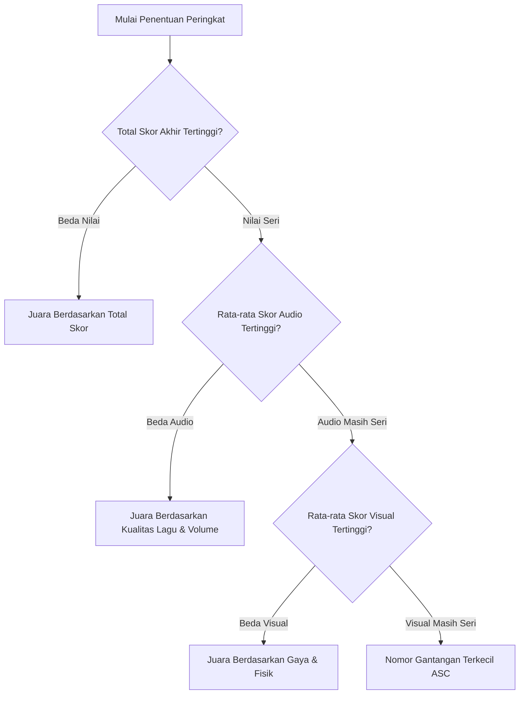

<div align="center">

# 🏆 KicauScore
### *Real-Time Multi-Judge Avian Singing Competition Platform*

Platform sistem informasi cerdas untuk digitalisasi penjurian dan manajemen kompetisi burung berkicau secara **akurat, transparan, anti-bentrok, dan real-time**.

[](https://laravel.com)
[](https://php.net)
[](https://tailwindcss.com)
[](https://sqlite.org)
[](https://azure.microsoft.com)
[](https://cloudflare.com)
[-10533F?style=for-the-badge&logo=pest&logoColor=white)](https://pestphp.com)
[](https://kicaumania.ardmst.my.id)

[🌐 Live Staging](https://kicaumania.ardmst.my.id) • [📊 Live Scoreboard](https://kicaumania.ardmst.my.id/scoreboard) • [🎯 Fitur Utama](#-fitur-unggulan) • [🛠️ Arsitektur](#%EF%B8%8F-arsitektur-dan-erd) • [🚀 Instalasi](#-panduan-instalasi-lokal) • [🔑 Akun Pengujian](#-akun-default-pengujian-database-seeder) • [👥 Tim Pengembang](#-tim-pengembang-kelompok-3)

---

</div>

## 📌 Latar Belakang & Perbandingan Sistem

Pada kompetisi burung berkicau konvensional, penilaian puluhan burung di tiang gantangan masih mengandalkan kertas tancap fisik dan rekap manual. Hal ini memicu lamanya pengumuman juara, potensi salah hitung, nomor gantangan ganda (*double booking*), hingga isu kecurangan "burung titipan".

| Aspek Penilaian | Sistem Konvensional (Kertas Manual) | Platform Digital KicauScore |
| :--- | :--- | :--- |
| **Input Nilai Juri** | Kertas tancap fisik di bawah tiang gantangan | Mobile-First UI (langsung input dari smartphone juri) |
| **Kalkulasi Juara** | Rekap kalkulator manual di meja panitia | **Real-time Average Scoring Engine** otomatis |
| **Penanganan Nilai Seri** | Tos koin / debat juri subjektif | **4-Tier Tie-Breaker Engine** berstandar pakem PBI & BnR |
| **Integritas Skor** | Nilai kertas rentan diubah diam-diam | **Immutable Audit Trail** (`penilaian_logs`) & Score Lock Policy |
| **Alokasi Gantangan** | Catat WhatsApp manual (rawan *double-booking*) | **Atomic Allocation** (`DB::transaction` & `lockForUpdate`) |
| **Publikasi Hasil** | Tunggu papan tulis diumumkan berjam-jam | **Live Scoreboard Asinkron (Auto-Polling 10 detik)** |
| **Histori Prestasi Burung** | Piagam kertas mudah rusak atau hilang | **Digital Avian Passport** publik (`/burung/{slug}`) |
| **Manajemen Kontes** | Dokumen terpisah-pisah untuk tiap kelas | **Unified Master Event & Category CRUD** terpadu |

---

## ✨ Fitur-Fitur Unggulan

### 1. 🎯 Multi-Judge Average Scoring Engine
Sistem menghitung rata-rata nilai akumulatif dari 3 hingga 6 juri secara instan setiap kali juri menyimpan penilaian. Penilaian mencakup dua kriteria utama:
- **Aspek Audio (Rentang 1.00 – 100.00):** Kualitas variasi irama lagu, volume tembus kristal, dan kestabilan durasi kerja 10 menit.
- **Aspek Visual (Rentang 1.00 – 100.00):** Gaya tarung (sujud/ngentrok), fisik tegap, dan keindahan gerak ekor.

### 2. ⚖️ 4-Tier Algoritma Tie-Breaker (Pemecah Nilai Seri)
Ketika terjadi nilai akhir yang sama persis antar-burung di akhir sesi lomba, sistem menentukan peringkat juara secara matematis:


### 3. 🛡️ Immutable Audit Trail & Penguncian Nilai (Score Lock Policy)
- **Log Revisi Otomatis:** Setiap kali juri merevisi nilai sebelum sesi ditutup, sistem mewajibkan pengisian alasan dan mencatat nilai lama, nilai baru, serta ID juri ke tabel `penilaian_logs`.
- **Penguncian Permanen:** Saat admin mengubah status kategori menjadi `validasi` atau `finished`, seluruh form penilaian terkunci otomatis (**HTTP 403 Forbidden** jika ada percobaan manipulasi nilai susulan).

### 4. ⚡ Concurrency-Safe Gantangan Allocation (`GantanganService`)
Menerapkan transaksi basis data ACID dan *Pessimistic Locking* (`lockForUpdate`). Ketika administrator memverifikasi bukti bayar peserta, nomor gantangan (`G-01` s.d. `G-36`) diterbitkan secara berurutan tanpa resiko duplikasi nomor, serta otomatis dirilis kembali jika pembayaran ditolak.

### 5. 📱 Mobile-First Thumb-Friendly Jury Experience
Antarmuka khusus perangkat genggam smartphone juri lapangan:
- Grid nomor gantangan dengan kode warna status (*Sudah Dinilai* vs *Belum Dinilai*).
- Tombol **"Simpan & Lanjut ke Gantangan Berikutnya"** untuk alur kerja cepat satu tangan di lapangan outdoor.
- Juri hanya dapat melihat dan menilai kelas/kategori yang ditugaskan kepada mereka via tabel pivot `kategori_juri`.

### 6. 🔄 Asynchronous Live Scoreboard (AJAX Auto-Polling)
Papan klasemen publik terhubung ke endpoint `/api/scoreboard`. Tabel klasemen dan kartu podium (Emas, Perak, Perunggu) terupdate otomatis setiap 10 detik tanpa me-reload halaman browser.

### 7. 📜 Portofolio Digital Burung Gacoan (`/burung/{slug}`)
Sertifikat rekam jejak digital publik yang menampilkan Nomor Ring kaki terdaftar, identitas pemilik, serta galeri trofi juara lengkap dengan rincian skor Audio-Visual.

### 8. ⏱️ Sinkronisasi Jadwal Otomatis (Auto-Schedule Sync)
Jika waktu pelaksanaan kompetisi telah mencapai `jam_mulai` pada hari event berlangsung, sistem secara otomatis mentransisikan kategori dari `upcoming` menjadi `ongoing` sehingga penjurian langsung aktif tanpa perlu intervensi manual.

### 9. 🎛️ Panel Manajemen Terpadu (All-in-One CRUD)
- **Event Management**: Tambah, edit jadwal tanggal & jam, lokasi arena gantangan, deskripsi, status event (`active`, `finished`, `draft`), serta hapus event.
- **Kategori Management**: Tambah dan edit kelas lomba, jenis burung, biaya tiket, kuota gantangan, jam pelaksanaan, tombol cepat 1-klik untuk status sesi (`Mulai Sesi`, `Kunci Nilai`, `Selesaikan`), sekaligus **penugasan dewan juri** dalam satu formulir terpusat.
- **Manajemen Pengguna**: Kelola akun Administrator, Dewan Juri, dan Peserta lengkap dengan pencarian dan filter peran.

---

## 🛠️ Arsitektur dan ERD

Proyek ini dibangun di atas **Laravel 13** dengan pola **MVC + Service Layer Architecture**, memisahkan logika bisnis kompleks ke dalam *Services*:
- `app/Services/ScoringEngineService.php` &rarr; Agregasi rata-rata multi-juri & kalkulasi 4-tier tie-breaker.
- `app/Services/GantanganService.php` &rarr; Alokasi nomor gantangan atomik anti-race-condition.

### Skema Relasi Basis Data (8 Tabel Inti)
```
┌──────────────┐       1:N       ┌──────────────┐       1:1       ┌──────────────┐
│    users     │────────────────>│   burungs    │────────────────>│ pendaftarans │
└──────────────┘                 └──────────────┘                 └──────┬───────┘
  │ 1:N     ▲ N:M                                                        │ N:1
  │         └────────────────────┌──────────────┐                        ▼
  │                              │kategori_juri │                 ┌──────────────┐
  ▼                              └──────┬───────┘                 │kategori_lomba│
┌──────────────┐                        │ N:M                     └──────┬───────┘
│  penilaians  │<───────────────────────┘                                │ N:1
└──────────────┘                                                         ▼
       ▲ 1:N                                                      ┌──────────────┐
┌──────────────┐                                                  │    events    │
│penilaian_logs│                                                  └──────────────┘
└──────────────┘
```

---

## 💻 Struktur Direktori Proyek

```
KicauScore/
├── app/
│   ├── Http/
│   │   ├── Controllers/       # Auth, Admin, Juri, Peserta, Public Controllers
│   │   └── Middleware/        # RoleMiddleware (RBAC Guard)
│   ├── Models/                # Eloquent Models (User, Event, KategoriLomba, Burung, Pendaftaran, Penilaian, dll)
│   ├── Policies/              # PenilaianPolicy (Score Lock Authorization)
│   └── Services/              # ScoringEngineService & GantanganService
├── database/
│   ├── migrations/            # 11 Skema Migrasi Tabel Relasional, Waktu Event, & Pivot Juri
│   └── seeders/               # DatabaseSeeder (Dataset Lengkap: 2 Admin, 10 Juri, 40 Peserta, 90 Burung, 4 Event)
├── public/
│   ├── favicon.svg            # Favicon Vektor Resmi KicauScore
│   └── favicon.ico            # Favicon Format Standar
├── resources/
│   └── views/
│       ├── layouts/           # Master Layout App & Juri Mobile Layout (Cross-Browser Gecko & Blink)
│       ├── public/            # Landing Page, Rundown, Scoreboard, & Profil Burung
│       ├── auth/              # Login & Register No. WhatsApp
│       ├── peserta/           # Dashboard, Koleksi Burung, Daftar Lomba, E-Tiket
│       ├── juri/              # Grid Dashboard & Form Penilaian Mobile Juri
│       └── admin/             # Dashboard, Events & Kategori CRUD, Kelola User, Verifikasi Queue
├── routes/
│   └── web.php                # Group Routing Berbasis Role & Public API Endpoints
└── tests/
    └── Feature/               # Automated Tests (17 Pest Tests, 79 Assertions Passed)
```

---

## 🚀 Panduan Instalasi Lokal

### Prasyarat Sistem
* **PHP:** Versi 8.4 atau lebih baru (dengan ekstensi `pdo_sqlite`, `mbstring`, `curl`, `openssl`)
* **Composer:** Versi 2.x
* **Node.js:** Versi 18+ & NPM (Opsional untuk asset build)

### Langkah Instalasi
```bash
# 1. Clone repositori dari GitHub
git clone https://github.com/Ardmst/Kicau-Score.git
cd Kicau-Score

# 2. Pasang seluruh dependensi PHP via Composer
composer install

# 3. Buat file konfigurasi environment lokal
cp .env.example .env

# 4. Generate Application Encryption Key
php artisan key:generate

# 5. Jalankan migrasi database dan isi dataset simulasi lengkap (seeder)
php artisan migrate:fresh --seed

# 6. Jalankan suite automated testing (Opsional)
php artisan test

# 7. Jalankan server lokal Laravel
php artisan serve
```

Aplikasi siap diakses melalui peramban di `http://127.0.0.1:8000`.

---

## 🔑 Akun Default Pengujian (Database Seeder)

Semua akun pengujian menggunakan kata sandi default: **`password`**

### 1. Akun Administrator
| Kode ID | Nama Administrator | Email | No. HP / WhatsApp |
| :---: | :--- | :--- | :--- |
| **`ADM-001`** | Administrator KicauScore | `admin@kicauscore.com` | `081234567890` |
| **`ADM-002`** | Panitia & Operator Lapangan | `panitia@kicauscore.com` | `081234567891` |

### 2. Dewan Juri Lapangan (10 Juri Bersertifikat)
| Kode ID | Nama Dewan Juri | Email | Asosiasi / Sertifikasi |
| :---: | :--- | :--- | :--- |
| **`JUR-001`** | Budi Santoso | `juri1@kicauscore.com` | Juri Senior BnR Pusat |
| **`JUR-002`** | Hendra Wijaya | `juri2@kicauscore.com` | Juri Nasional PBI |
| **`JUR-003`** | Agus Pratama | `juri3@kicauscore.com` | Pelestari Burung Indonesia |
| **`JUR-004`** | Slamet Riyadi | `juri4@kicauscore.com` | Radjawali Indonesia |
| **`JUR-005`** | Joko Susilo | `juri5@kicauscore.com` | Oriq Jaya Indonesia |
| **`JUR-006`** | Eko Wahyudi | `juri6@kicauscore.com` | Ronggolawe Nusantara |
| **`JUR-007`** | Dedi Kurniawan | `juri7@kicauscore.com` | RGN Independent |
| **`JUR-008`** | Wahyu Hidayat | `juri8@kicauscore.com` | Master Murai Batu |
| **`JUR-009`** | Arif Budiman | `juri9@kicauscore.com` | Master Cucak Ijo & Kacer |
| **`JUR-010`** | Bambang Setiawan | `juri10@kicauscore.com` | Master Lovebird & Kenari |

### 3. Akun Peserta Contoh
Tersedia **40 Peserta** (`PST-001` s.d. `PST-040`) dengan email `peserta1@kicauscore.com` s.d. `peserta40@kicauscore.com`, masing-masing memegang **minimal 2 burung gacoan** (total 90 burung dengan nomor ring resmi).

### 4. Master Event Tersedia
1. **Piala Raja Mangkunegaran 2026** (Status: `finished` / Tanggal Lewat): Hasil dan podium juara telah tervalidasi dan terkunci.
2. **Kicau Nusantara Cup 2026** (Status: `active` / Hari Ini): Kategori Murai Batu VIP 36G sedang berlangsung (`ongoing`) dengan skor live aktif di scoreboard.
3. **Piala Presiden Kicaumania 2026** (Status: `active` / +7 Hari): Pendaftaran dibuka, terdapat antrian pendaftaran `pending` untuk demo verifikasi admin.
4. **Grand Prix BnR Indonesia Master 2026** (Status: `active` / +14 Hari): Pendaftaran dibuka untuk kelas bergengsi se-Asia.

---

## 🌐 Infrastruktur Cloud & Deployment

Sistem telah di-deploy dan dapat diuji secara langsung pada lingkungan produksi:
* **Domain Produksi:** [https://kicaumania.ardmst.my.id](https://kicaumania.ardmst.my.id)
* **Cloud Platform:** Microsoft Azure Virtual Machine (Ubuntu 24.04 LTS, 2 vCPU, 4 GiB RAM)
* **Web Server:** Nginx 1.24 dengan proteksi pemblokiran akses langsung ke file sensitif (`.env`, `.git`, `.sqlite`)
* **PHP Runtime:** PHP 8.4-FPM
* **Security & SSL:** Cloudflare Edge Proxy + Let's Encrypt SSL Certificate (Full Strict)

---

## 👥 Tim Pengembang (Kelompok 3)

| Nama Anggota | Peran / Jabatan | Modul & Tanggung Jawab Utama |
| :--- | :--- | :--- |
| **Ardi** | **Project Manager, Lead Architect & DevOps** | Arsitektur MVC & Service Layer, skema database migrations, concurrency service (`GantanganService`), deployment VPS, security hardening, dan manajemen rilis. |
| **Rafly** | **Backend Developer (Scoring Engine & Validasi)** | Algoritma rata-rata multi-juri, 4-Tier Tie-Breaker, controller juri lapangan, audit trail revisi skor, & automated testing. |
| **Daaris** | **Backend Developer (Auth, Event & Transaksi)** | Autentikasi No. WA, RoleMiddleware (RBAC), CRUD Event & Kategori, manajemen akun pengguna, dan database seeder. |
| **Natasya** | **Frontend UI/UX (Portal Publik & Peserta)** | Design system responsif, landing page jadwal lomba, dashboard peserta, formulir pendaftaran, dan portofolio rekam jejak burung. |
| **Hasna** | **Frontend UI/UX (Juri & Admin) & QA / Tech Writer** | Antarmuka juri mobile-first, papan live scoreboard asinkron, panel verifikasi admin, matriks pengujian UAT, dan dokumentasi. |

---

## 📄 Lisensi

Proyek ini dikembangkan sebagai pemenuhan Tugas Besar mata kuliah **Praktikum Pemrograman 2** dan dirilis di bawah lisensi [MIT License](LICENSE).
